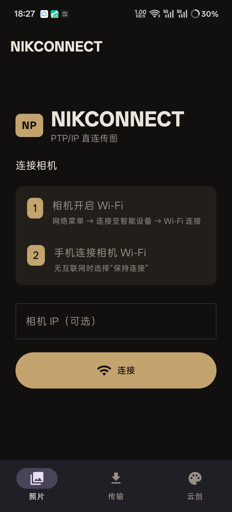
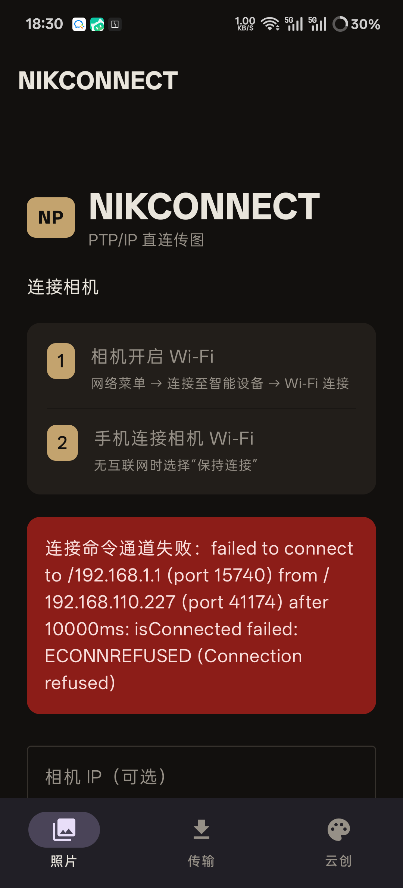
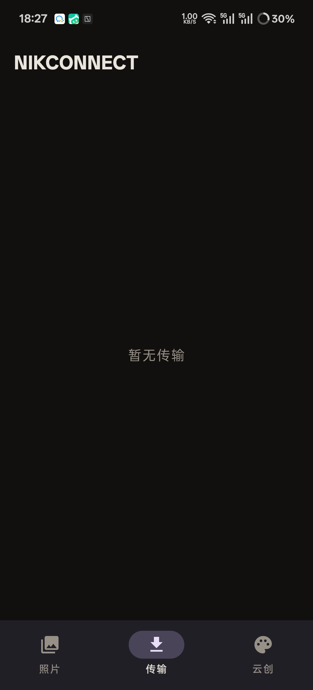
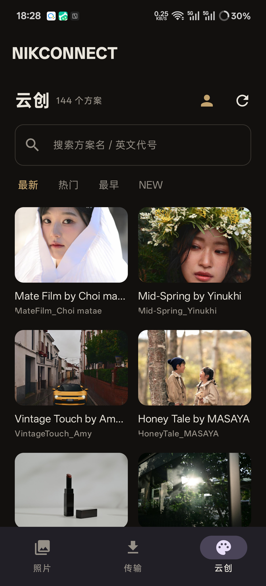
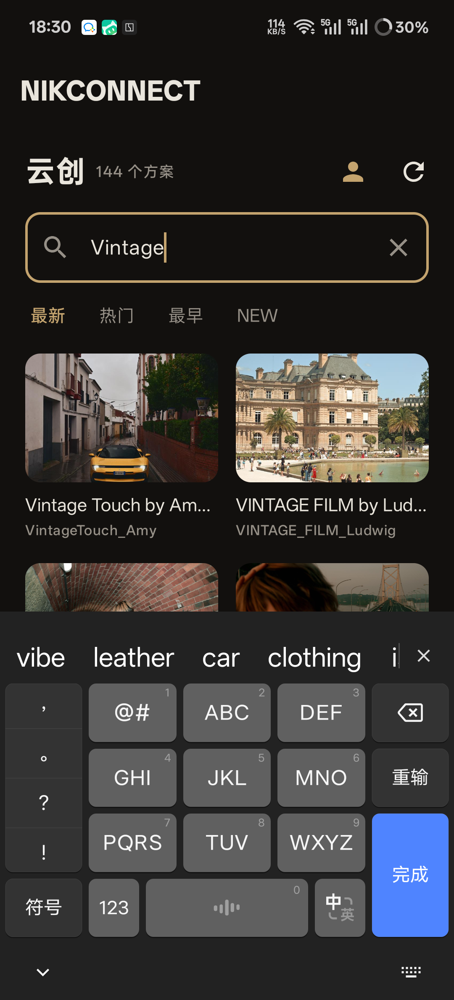
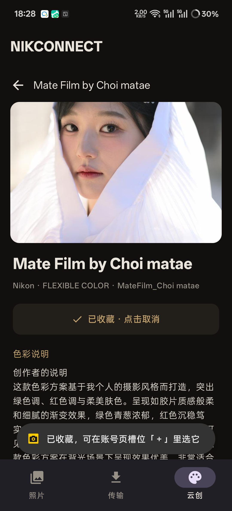
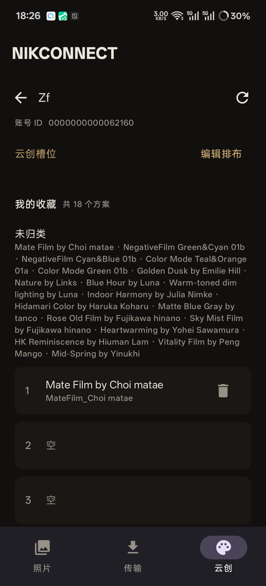
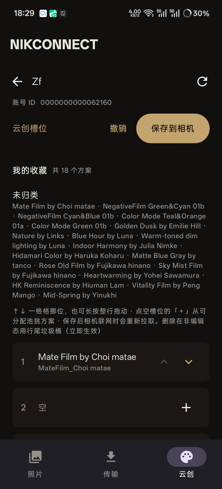
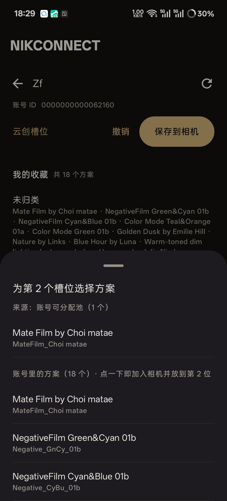

# NiKConnect UI 与交互检查报告

- **检查日期**：2026-11-13
- **检查设备**：OPPO PKR110，1080 × 2376，Android 真机
- **检查方式**：无线 ADB 逐页点击、截图、UI 控件树检查，并结合 Jetpack Compose 源码核对
- **检查范围**：照片连接页、传输空状态、云创列表、搜索、方案详情、账号相机槽位、排布编辑、方案选择弹层
- **本轮范围**：仅审查与记录；未修改应用代码，未执行取消收藏、删除槽位或保存排布

## 1. 结论摘要

当前最主要的问题不是单一配色，而是**信息架构、操作优先级、状态反馈和导航层级不统一**，整体仍带有明显的功能调试界面特征。

优先处理以下问题：

1. **P0：账号页把收藏全文放在槽位之前**，导致核心槽位操作被长文本推到下方。
2. **P0：连接失败直接展示底层异常**，红色错误区域过大，并把主要操作挤到首屏之外。
3. **P0：详情页缺少直接的“添加到相机”主路径**，用户需要在账号页和编辑模式之间反复理解规则。
4. **P1：品牌头部重复且占高过多**，压缩了有效内容区域。
5. **P1：金色、紫色和不同按钮样式的语义不统一**，难以从视觉判断可操作性与选中状态。
6. **P1：二级页面保留底部主导航**，返回与切 Tab 形成两套并行导航逻辑。

## 2. 全局视觉与导航

### 2.1 品牌头部重复、占用空间过多

- 所有主页面都使用大号 `NIKCONNECT` 顶栏。
- 照片连接页又出现一次带 NP 图标的 `NIKCONNECT`，同一屏幕形成重复品牌标题。
- 详情页同时存在顶栏方案名与正文大标题，也构成重复。

**建议**：主页面保留轻量品牌栏；二级页面只保留上下文标题；连接页移除第二个品牌头。

**证据**：[连接页双品牌标题](ui-audit-assets/02-camera-connection.png)、[详情页重复标题](ui-audit-assets/05-cloud-detail.png)

### 2.2 颜色语义不统一

- 金色同时用于品牌、章节标题、可点击文字、主动作和选中态。
- 底部导航选中胶囊为紫色，与页面金色体系割裂。
- 次要灰色文字使用较多，在小字号、长段说明中阅读压力较大。

**建议**：金色仅承担主动作和选中状态；普通章节标题使用主前景色；底部选中态与全局主色统一。

### 2.3 页面层级和返回逻辑不够清楚

- 列表、详情、账号和槽位通过内容替换切换，空间层级感弱。
- 二级页仍显示三个底部 Tab，用户既可以使用返回，又可以直接切换主 Tab。
- 账号页顶部只显示 `Zf`，缺少“云创账号 → 相机 → 云创槽位”的上下文。

**建议**：三个主页面保留底部导航；详情与账号管理使用独立二级导航层，并明确标题和返回目标。

## 3. 照片／相机连接页

### UI 问题

1. 品牌区占高过大，同一页出现两次产品名称。
2. 首屏上半部留白较多，连接主按钮的视觉优先级被品牌区削弱。
3. 步骤卡、IP 输入框和连接按钮之间间距偏大，页面纵向效率低。
4. 页面入口名为“照片”，未连接时实际内容是“连接相机”，入口名称与当前内容不完全一致。

### 交互问题

1. “相机 IP（可选）”没有示例、默认值或适用场景说明。
2. 没有看到直接跳转系统 Wi-Fi 设置的入口，也没有明确显示当前手机 Wi-Fi 是否满足连接条件。
3. 连接过程中主要依赖按钮文案变化，缺少分阶段状态，例如“寻找相机 → 建立会话 → 读取照片”。

### 连接失败状态

1. 直接展示 `failed to connect`、端口、本机 IP、`ECONNREFUSED` 等底层异常。
2. 红色错误卡占据接近半屏，将 IP 输入和连接操作推到首屏下方。
3. 用户无法从错误文本快速判断下一步应检查相机还是手机网络。

**建议**：默认展示“未找到相机，请确认手机已连接相机 Wi-Fi”，提供“打开 Wi-Fi 设置”“重试”“查看诊断详情”三个操作；技术异常收纳到可展开诊断区。

## 4. 传输页

### UI 与交互问题

1. 页面没有标题，只有底部 Tab 能说明当前位置。
2. “暂无传输”孤立在屏幕中央，没有解释该页面用途。
3. 没有“去选择照片”等引导，空状态无法帮助用户开始下一步。
4. 已完成、失败、取消等任务状态尚未通过本轮真机操作验证。

**建议**：增加“传输”标题、用途说明和“去选择照片”按钮；有任务后保留统计与筛选。

### 源码核对发现

任务统计卡位于独立 `Row`，后续任务列表使用另一个 `LazyColumn`，两者没有共同的纵向布局容器，任务较多时存在统计区与列表重叠风险。

**源码位置**：[MainScreen.kt:640-663](../app/src/main/java/com/chrisz/nikconnect/ui/MainScreen.kt#L640-L663)

> 此项属于源码推断，尚未通过大量任务的真机界面复现。

## 5. 云创列表

### UI 问题

1. 品牌、“云创”、方案数量形成较高的顶部区域，压缩首屏图片数量。
2. “最新／热门／最早／NEW”样式一致，但前三项是排序，NEW 是筛选，控件类型与行为不对等。
3. 卡片名称常被省略，第二行英文代号重复占用空间。
4. “热门”缺少热度解释，卡片上的点赞信息视觉权重也较低。

### 交互问题

1. 搜索输入框说明“方案名／英文代号”，但没有说明作者是否可搜索。
2. 搜索后没有结果数量，用户不容易判断筛选范围。
3. NEW 筛选与排序没有组合状态说明。

**建议**：将排序与 NEW 筛选分组；名称允许两行，英文代号放入详情；搜索结果区域显示“找到 N 个方案”。

### 搜索实测

已验证搜索能即时过滤，清空按钮明确，键盘弹出后未发现横向溢出。搜索体验基础可用，主要问题在结果信息与筛选语义。

## 6. 方案详情

### UI 问题

1. 顶栏与正文重复显示方案名称。
2. 头图、标题、元信息和收藏按钮纵向占用较大，核心操作不够集中。
3. “已收藏 · 点击取消”同时承担状态与操作说明，按钮文案偏工程化。
4. `IF_FR100_H05 认证失败（403）` 以裸接口信息插入正文，打断阅读。
5. 成功 Toast 与错误提示可能同时占据正文区域，反馈缺少统一容器。

### 交互问题

1. 只有“收藏”主操作，没有直接的“添加到相机”入口。
2. Toast 引导用户去账号页槽位的“＋”，但“＋”实际只在编辑模式出现，指引不完整。
3. 上一项／下一项位于长正文、参数和 EXIF 后面，连续浏览成本高。
4. 长页面没有固定或便于抵达的核心操作区。

**建议**：头图下设置“收藏／添加到相机”双动作；认证错误转为“登录已过期，请重新登录”；上一项／下一项移至顶部或提供左右切换。

## 7. 账号、收藏与相机槽位

### UI 问题

1. **18 个收藏名称被拼接为整段文本，占据页面核心区域。**
2. 真正需要查看和操作的相机槽位被推到收藏文本之后。
3. 收藏条目没有缩略图、分隔或逐项状态，扫读困难。
4. 账号 ID 长期占据一行，日常价值低但增加了调试界面感。

### 交互问题

1. 收藏名称不可逐项打开详情，也不能直接添加至槽位。
2. 非编辑态空槽位没有明显“添加”入口，用户必须先理解“编辑排布”。
3. 收藏、可分配池和槽位三个概念同时出现，但页面没有直观解释它们的转换关系。

**建议**：槽位放在收藏之前；收藏改为可折叠、可搜索、逐项可操作的列表；空槽位始终提供“＋ 添加方案”；账号 ID 收纳到账号信息或诊断页。

## 8. 排布编辑

### UI 与交互问题

1. 需要整段文字解释拖动、添加、删除和保存，说明界面本身缺少直观性。
2. “撤销”实际用于退出整个编辑状态，容易被理解为仅撤销最近一步。
3. 同时提供上下箭头与长按拖动，但缺少明确的拖动手柄。
4. “保存到相机”容易让用户认为立即直接写入相机，实际流程是提交账号后由相机联网同步。
5. 编辑状态与非编辑状态的操作差异较大，学习成本较高。

**建议**：“撤销”改为“取消”；“保存到相机”改为“保存排布”；增加拖动手柄和拖动中的目标位置提示；成功反馈写明“相机联网同步后生效”。

## 9. 方案选择弹层

### UI 与交互问题

1. 同一方案可同时出现在“账号可分配池”和“账号里的方案”，用户难以判断选择差异。
2. 两个列表都缺少封面、搜索和槽位占用状态。
3. “点一下即加入相机”提前承诺结果，实际仍需保存排布。
4. 收藏数量较多时，长列表缺少定位与筛选能力。

**建议**：合并为统一选择列表；每项显示“已在槽位 N／可添加”；点击只更新草稿，并明确“保存后生效”；增加搜索和已占用过滤。

## 10. 尚未完成真机验证的页面

以下项目已核对源码，但手机当前连接普通 Wi-Fi，相机连接被拒绝，因此没有作为真机事实下结论：

- 照片网格的加载、筛选与三种视图尺寸。
- 长按选择、多选与批量下载。
- 照片预览、下载后状态和已下载标识。
- 有任务的传输列表、失败重试和取消操作。
- 云创登录 WebView 的加载和返回流程。

### 源码层面值得后续重点验证

1. 照片选择依赖长按，未看到常驻“选择”入口，发现成本较高。
2. 照片预览使用缩略图，界面没有明确说明并非高清原图。
3. 传输完成只有“已保存到相册”，缺少“查看照片／打开相册”。
4. 登录等待 25 秒后才出现辅助提示，前期缺少原生加载进度。

## 11. 推荐整改顺序

### P0：先修核心任务流

- 槽位置顶，收藏列表化，空槽位直接添加。
- 详情增加“添加到相机”，统一收藏、草稿与保存语义。
- 连接失败改为用户可理解的提示与明确下一步。

### P1：统一导航与页面骨架

- 缩减品牌头部，消除重复标题。
- 二级页面移除底部主导航，明确返回层级。
- 统一标题、边距、章节间距、主色与选中规则。
- 给传输空状态增加任务说明与照片页引导。

### P2：减少调试感并统一反馈

- 接口码、IP、端口和原始响应收进诊断详情。
- 精简英文代号、重复标题和长段操作说明。
- 统一加载、成功、失败、撤销反馈组件。

## 12. 验证记录与证据清单

| 编号 | 页面／状态 | 证据 |
|---|---|---|
| 01 | 账号、收藏与槽位 | [截图](ui-audit-assets/01-account-slots.png) |
| 02 | 相机连接初始状态 | [截图](ui-audit-assets/02-camera-connection.png) |
| 03 | 传输空状态 | [截图](ui-audit-assets/03-transfer-empty.png) |
| 04 | 云创列表 | [截图](ui-audit-assets/04-cloud-catalog.png) |
| 05 | 云创方案详情 | [截图](ui-audit-assets/05-cloud-detail.png) |
| 06 | 槽位排布编辑 | [截图](ui-audit-assets/06-slot-editing.png) |
| 07 | 槽位方案选择弹层 | [截图](ui-audit-assets/07-slot-picker.png) |
| 08 | 云创搜索状态 | [截图](ui-audit-assets/08-cloud-search.png) |
| 09 | 相机连接失败 | [截图](ui-audit-assets/09-connection-error.png) |

---

**证据说明**：截图来自 2026-11-13 的 PKR110 真机运行状态；源码推断已在对应位置单独标注，不与真机实测混写。
