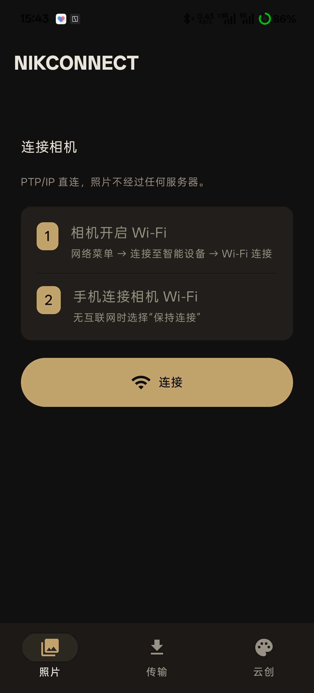
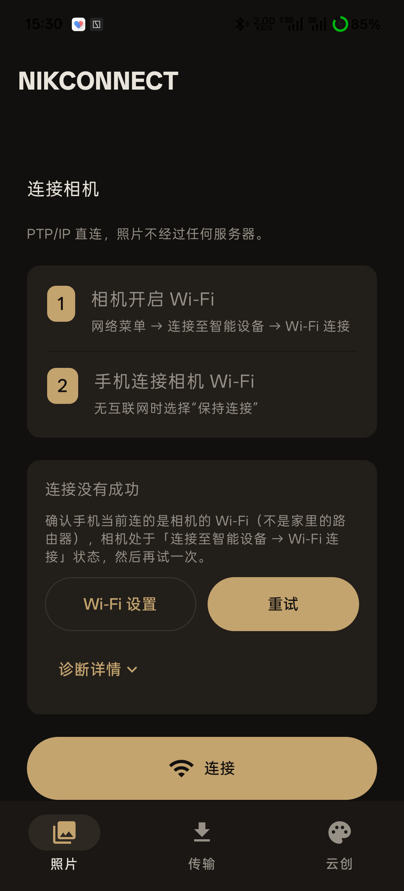
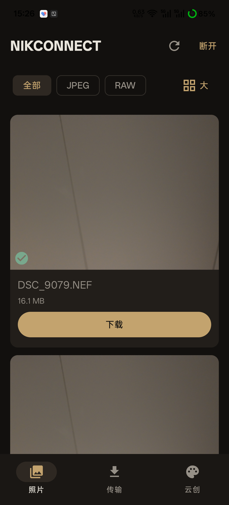
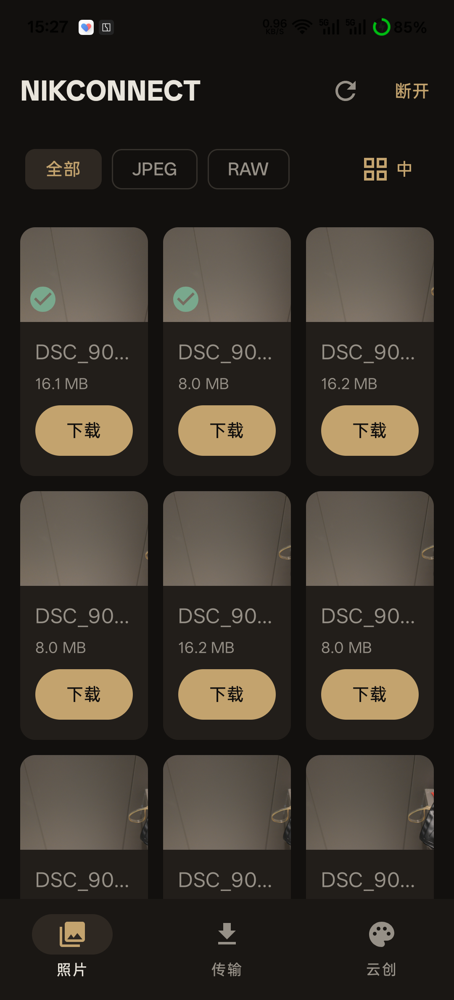
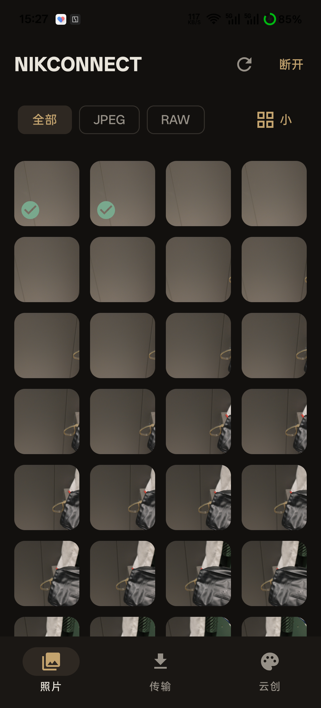
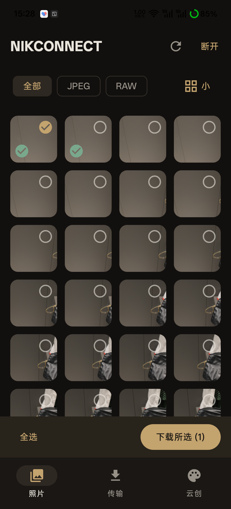
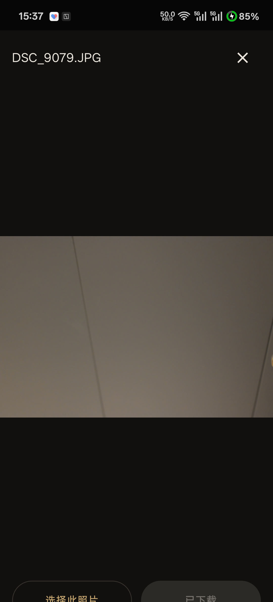
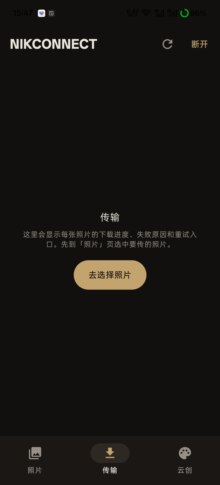
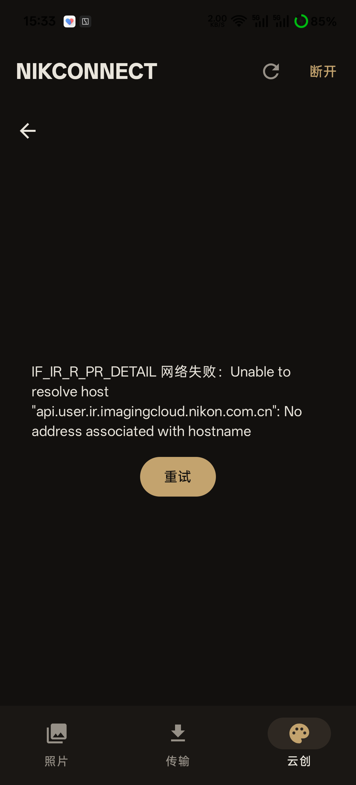
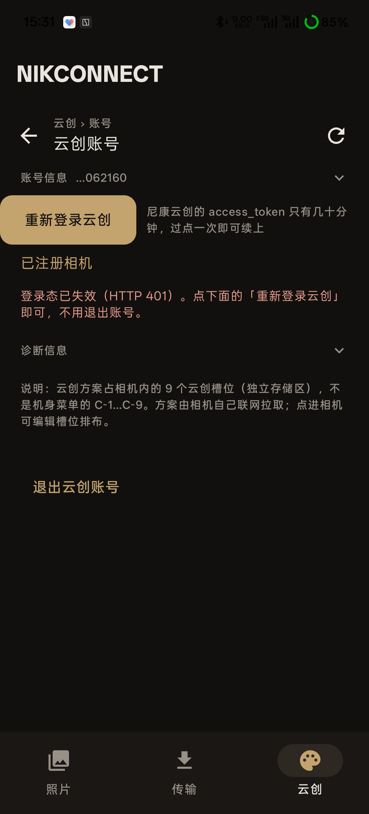

# NiKConnect UI / 交互审查（第二轮）

> 日期：2026-11-14  
> 设备：PKR110，1080 × 2376  
> 方式：无线 ADB 真机操作、截图与 UI 层级核对、Compose 源码核对  
> 范围：连接、照片列表、筛选与多选、照片预览、传输、云创列表、云创详情、账号。只审查，未修改应用代码。

## 结论先行

这一轮解决了上一轮的一部分表层问题：连接页不再重复输入 IP，错误卡可折叠诊断，传输空状态有了 CTA，账号页有了返回入口。但整体仍然像“功能组件的集合”，不是一个围绕照片组织的产品。

最需要优先处理的是四件事：

1. **预览页底部按钮被裁切**：核心下载操作直接撞到屏幕下沿，属于可用性问题。
2. **传输页布局会重叠**：统计卡片和任务列表分别排在同一内容区域，顶部两个角和列表内容会相互穿透。
3. **照片页大、中、小三种模式缺乏真正的产品差异**：大中模式只是重复卡片大小，信息层级与操作没有随场景变化。
4. **页面平铺和卡片堆叠仍然严重**：连接步骤、错误、统计、云创条目都靠独立容器表达层级，信息没有形成“标题—内容—动作”的主次。

## 优先级总览

| 优先级 | 页面 | 问题 | 影响 |
|---|---|---|---|
| P0 | 照片预览 | 底部“选择此照片 / 下载这张”被系统导航区裁切 | 核心动作难点击，视觉明显未完成 |
| P0 | 传输 | 统计行与任务列表无共同纵向容器，存在覆盖关系 | 顶部角穿透、内容遮挡、滚动异常 |
| P1 | 全局 | 相机“刷新照片 / 断开”出现在传输和云创页 | 当前页面与顶栏动作语义不一致 |
| P1 | 照片列表 | 大中视图仍是同构卡片；下载、文件名、大小平均分配注意力 | 浏览效率低、视觉死板、不像照片产品 |
| P1 | 云创详情 | DNS/域名错误原文直接占据页面 | 用户无法判断下一步该做什么 |
| P1 | 云创详情 | 缺少“加入相机 / 收藏 / 应用到槽位”的主行动 | 看完详情后流程中断 |
| P1 | 传输 | 重连会清空下载结果；传输页无历史摘要 | 完成后像什么都没发生过 |
| P2 | 连接 | 步骤卡、错误卡、底部大按钮仍堆叠 | 页面纵向过长，主行动不够聚焦 |
| P2 | 云创列表 | 标题、英文代号、卡片副标题重复 | 阅读密度低，卡片外框替代了排版 |
| P2 | 账号 | access_token 技术说明直接暴露 | 账号页像调试界面 |
| P2 | 多选 | 只能长按发现；视图按钮也没有状态选择菜单 | 功能可发现性弱 |

---

## 1. 连接页

### 已改善

- 删除了重复品牌区和手动 IP 输入，连接路径更短。
- 保留两步连接说明，首屏可以理解基本操作。
- 错误页已经改为用户说明 + Wi-Fi 设置 + 重试 + 折叠诊断，比上一轮直接展示 socket 错误好。

### 仍存在的问题

**P2 — 页面靠三个大块堆叠，主次仍不够明确。**

“连接相机”、一句技术说明、步骤卡、错误卡、底部大连接按钮依次平铺。错误出现时，用户需要越过错误卡再找另一个“连接”按钮；失败卡和主按钮形成两个重试入口。

建议：

- 将“PTP/IP 直连”弱化为辅助说明，不必占据独立大间距。
- 失败状态把主按钮直接变为“重新连接”；删除错误卡内重复的“重试”。
- 两步说明改为无卡片的编号列表，用间距和细分隔线区分，不再加一层大卡片。
- 未连接时顶栏可显示小型相机状态；连接页只保留一个主 CTA。

---

## 2. 照片列表：大、中、小视图

### 大视图

**P1 — 大视图不是“照片浏览”，而是两张大功能卡。**

每张照片都被拆成图片、文件名、大小、下载按钮四块等权信息。首屏只看到两张照片，照片之间由粗重外框分割，用户注意力落在按钮和卡片边框，而不是照片内容。

建议：

- 大视图改为一张图占主要宽度的沉浸式浏览，文件名与大小合并为一行弱信息。
- 下载改为图片右下角的小型图标动作，或底部浮动操作条；已下载后保留状态但不再显示同权重“下载”。
- 可考虑上下滑动切换照片，形成“浏览—预览—下载”的连续路径，而不是滚动卡片列表。

### 中视图

**P1 — 中视图与大视图只是尺寸缩小，没有改变信息策略。**

两列仍保留文件名、大小和整宽下载按钮，导致图片面积被文字与按钮挤压。卡片间距 12dp、内边距 12dp、外框和按钮同时存在，视觉上像商品列表。

建议：

- 中视图以两列大图为主，去掉永久下载按钮。
- 文件名只在长按/详情中展示；列表中仅保留 JPEG/RAW、已下载、选中三类轻量角标。
- 通过底部渐变或浮动小图标承载必要状态，避免每张照片一块独立文字面板。

### 小视图

小视图是三种模式里最接近正确方向的：图片占主体、四列、信息克制。

仍可改进：

- 12dp 的横纵间距对小图过大，可降到 2–4dp，让照片形成连续的画廊。
- 四角状态图标需要稳定位置与背景，避免落到复杂照片上后难以识别。
- 增加“选择”入口，不依赖用户猜测长按。

### 筛选与视图切换

- 全部 / JPEG / RAW 筛选可正常工作。
- “大 / 中 / 小”通过同一个按钮循环切换，没有展开选择，也无法直接跳到目标模式。
- 建议改成分段控件或底部视图菜单，并显示三种布局预览图标。
- 筛选为空时应显示“没有 RAW 照片，查看全部”，而不是通用“暂无照片”。

---

## 3. 多选与下载

### 已确认可用

- 长按约 1.5 秒可进入多选。
- 支持继续点选、全选、下载所选。
- 选中态有明确图标与颜色反馈。

### 问题

**P2 — 多选入口不可发现。**

页面没有“选择”按钮，只有长按手势。对工具型 App 来说，这会让批量下载能力长期隐藏。

**P2 — 下载前确认文案对小任务不够完整。**

大于约 200MB 时才说明保存到相册 NiKConnect 文件夹；小任务只显示容量。建议所有批量下载都统一显示保存位置、张数和容量。

**P2 — 已下载状态与下载动作权重冲突。**

大图已下载徽标与下载按钮同时存在。建议默认显示“已下载”，再次下载放入更多菜单。

---

## 4. 照片预览

### P0 — 底部操作区被屏幕裁切

真机 UI 层级显示：

- 图片区域到 y=2244；
- 底部按钮从 y=2292 开始；
- 屏幕底部为 y=2376，按钮文字从下沿开始被截断。

源码对应 `app/src/main/java/com/chrisz/nikconnect/ui/MainScreen.kt:598-637`：全屏 Dialog 使用 `fillMaxSize()`，底部 Row 只有 `padding(16.dp)`，缺少导航栏 inset。

建议：

- 底部操作条增加 `navigationBarsPadding()`，顶部增加 `statusBarsPadding()`。
- 让图片区域基于扣除系统栏后的可用高度布局。
- 对 1080×2376、小屏、三键导航和手势导航分别做回归。

### P1 — “预览”仍只是缩略图放大

预览加载的仍是 `thumbnailLoader(photo.handle)`，并用 Fit 放大。它不是高清预览，也没有缩放、滑动切换、EXIF 或格式信息。

建议：

- 第一阶段明确文案为“缩略图预览”；后续增加双击缩放和左右切换。
- 预览底部保留一个主动作即可：未下载显示“下载”，已下载显示“已保存到相册”。
- “选择此照片”与“下载这张”的关系需更明确；当前用户容易理解为两个互斥动作。

---

## 5. 传输页

### 已改善

- 空状态已有说明和“去选择照片”CTA，路径比上一轮清楚。

### P0 — 有任务时统计卡片与列表重叠

源码 `app/src/main/java/com/chrisz/nikconnect/ui/MainScreen.kt:649-685` 中，统计 `Row` 和 `LazyColumn` 是同一 Composable 中先后排放的两个子视图，没有外层 `Column`。LazyColumn 从内容区顶部开始布局，会覆盖统计行。

这正好解释了你指出的“上面两个角穿透”：不是圆角素材问题，而是两个布局同时占用了顶部空间。

建议：

- 使用一个 `Column(fillMaxSize())` 包裹统计摘要与任务列表，列表设置 `weight(1f)`。
- 或更简单地只保留 `LazyColumn`，把统计摘要作为第一个 `item`。
- 有任务截图必须覆盖“滚动前后 + 完成/失败混合状态”，当前空状态截图无法暴露这个问题。

### P1 — 完成结果缺少持续反馈

单张 RAW 下载后预览显示“已下载”，但传输页仍显示空状态；重新连接还会清空 `downloads`（`MainViewModel.kt:163-180`）。

这会让用户在传完后找不到结果，也无法打开保存位置。建议：

- 传输页按“进行中 / 已完成 / 失败”分组。
- 至少保留本次 App 会话内的完成记录；重连不应把历史结果伪装成空状态。
- 完成项提供“在相册中查看”；失败项提供简化原因与重试。
- 底部导航在有活动任务时显示数量或小圆点。

### P1 — 顶栏显示无关相机操作

当前截图中，传输页仍显示“刷新照片 / 断开”。刷新照片对传输页没有明确意义。

---

## 6. 云创列表

### 已改善

- 搜索与排序可用，NEW 标签已移除。

### P2 — 卡片重复文本与堆叠感明显

卡片同时出现大标题、英文代号、重复名称和描述，多个字体层级在争夺注意力。标题“NIKCONNECT”“云创”“144 个方案”、搜索、排序、账号入口全部独立占行，首屏真正方案数量偏少。

建议：

- 每个方案只保留一个主名称；英文代号作为次要信息或只在详情展示。
- 列表改为无卡片的两列作品网格：封面为主，名称置于图下，收藏与状态用角标。
- 顶栏在滚动时收缩；搜索、排序与账号合并到一条工具栏。
- 热门排序若依赖用户点击，应显示依据；否则用户无法理解与“最新”的差别。

---

## 7. 云创详情

### P1 — 技术错误直接成为页面主体

实测显示：`IF_IR_R_PR_DETAIL 网络失败：Unable to resolve host ... No address associated with hostname`。

问题不是错误信息不够详细，而是把诊断信息当成了用户界面。与此同时，顶栏还残留“刷新照片 / 断开”，进一步混淆了相机连接和云端网络。

建议：

- 主文案：“云端内容加载失败，请检查网络后重试”。
- 提供“重试”与“返回列表”；域名与接口编号放入折叠诊断。
- 云端请求错误不要复用相机全局错误和相机顶栏。
- 加载态使用与最终布局一致的骨架，避免长时间空白后突然变成错误页。

### P1 — 详情缺少主行动

成功详情应围绕“这个方案是否值得用、如何加入相机”组织，而不是重复标题与说明。底部或首屏应有明确 CTA：收藏、应用到槽位、查看参数。

---

## 8. 云创账号

### 已改善

- 新增返回与面包屑，二级页面定位比上一轮清楚。
- 账号信息可以折叠。

### P2 — 仍有调试面板感

“access_token 不会写入日志或持久化”属于实现说明，不是用户需要理解的内容。当前 HTTP 401 使槽位流程被登录状态阻断，页面却缺少“会话已失效，请重新登录”的明确状态。

建议：

- 将 token 说明移入隐私说明或调试页。
- 401 时统一显示会话失效状态，并提供重新登录。
- 页面优先展示收藏与相机槽位；账号信息折叠到底部。
- 账号与槽位为空时用图示 + 一条行动路径，而不是长段技术解释。

---

## 推荐的整体改版方向

### A. 照片页：从“文件卡片列表”变成“相机胶卷”

- **大视图**：一张图 + 一行弱信息 + 浮动动作。
- **中视图**：两列照片，去掉永久按钮与文字面板。
- **小视图**：四列紧密网格，间距 2–4dp。
- 顶栏只保留照片相关动作；选择、筛选、视图切换形成一条工具栏。
- 选中后底部出现上下文操作条，下载完成后出现可打开相册的反馈。

### B. 传输页：从“空页面 + 统计卡”变成“任务中心”

- 顶部用一行摘要，不要三张统计卡。
- 任务按状态分组，完成历史可追溯。
- 顶栏不再出现刷新照片。
- 修复统计与列表的共同布局容器，优先于任何视觉美化。

### C. 云创：从“接口内容陈列”变成“方案发现与应用”

- 列表由封面和名称驱动，不再多层卡片。
- 详情围绕参数和“加入相机”组织。
- 网络失败、登录失效、相机未连接分别表达，不混用一套错误文案。

## 本轮建议实施顺序

1. 修预览页系统栏 inset 和传输页重叠。
2. 让顶栏动作随当前 Tab 变化。
3. 重做照片大/中/小视图的信息层级与小图间距。
4. 保留传输结果，补“查看相册”和任务反馈。
5. 云创列表去重复文本、详情补 CTA、统一错误与登录状态。
6. 最后处理连接页去卡片化和账号页技术信息收纳。

## 未验证项与证据边界

- 传输有任务状态的真机截图本轮未可靠捕获；重叠结论来自源码布局核对，置信度高，但应补一张任务态截图作为最终证据。
- 云创详情遇到 DNS 失败，未验证成功详情的完整参数、收藏和应用到相机流程。
- 账号接口返回 HTTP 401，未继续验证槽位编辑和保存到相机。
- 照片预览已确认底部裁切；高清大图加载、双指缩放、左右切换当前未实现/未验证。
- 单张 RAW 下载在预览中显示已下载；传输页为空且重连会清空结果，因此本轮不把完整下载历史与后台恢复写成通过。
- 未修改应用源码，未运行构建或 JVM 测试；本轮为 UI / 交互专项审查。

## 源码依据

- `app/src/main/java/com/chrisz/nikconnect/ui/MainScreen.kt:135-176`：全局顶栏与底部导航。
- `app/src/main/java/com/chrisz/nikconnect/ui/MainScreen.kt:298-370`：筛选、视图切换与照片网格。
- `app/src/main/java/com/chrisz/nikconnect/ui/MainScreen.kt:493-564`：照片卡片和下载按钮。
- `app/src/main/java/com/chrisz/nikconnect/ui/MainScreen.kt:598-637`：全屏预览及底部按钮。
- `app/src/main/java/com/chrisz/nikconnect/ui/MainScreen.kt:649-685`：传输统计与列表布局。
- `app/src/main/java/com/chrisz/nikconnect/ui/MainViewModel.kt:163-180`：重连清空下载列表。
