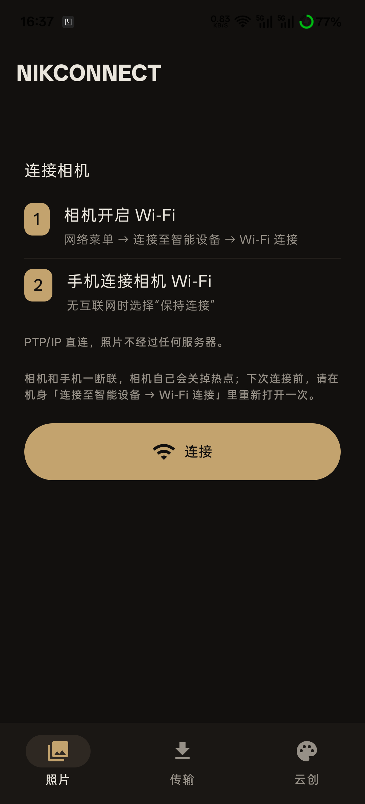
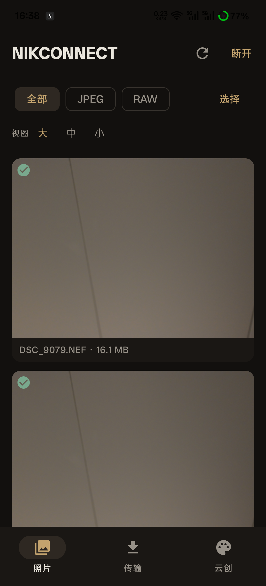
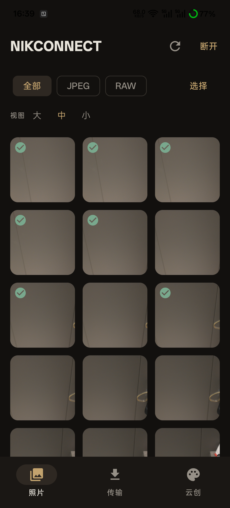
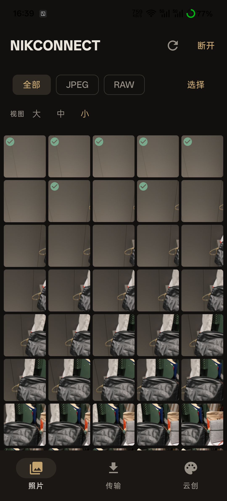
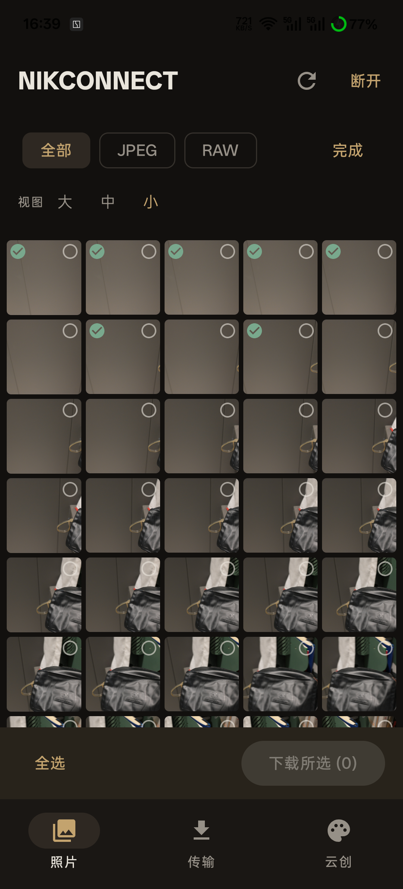
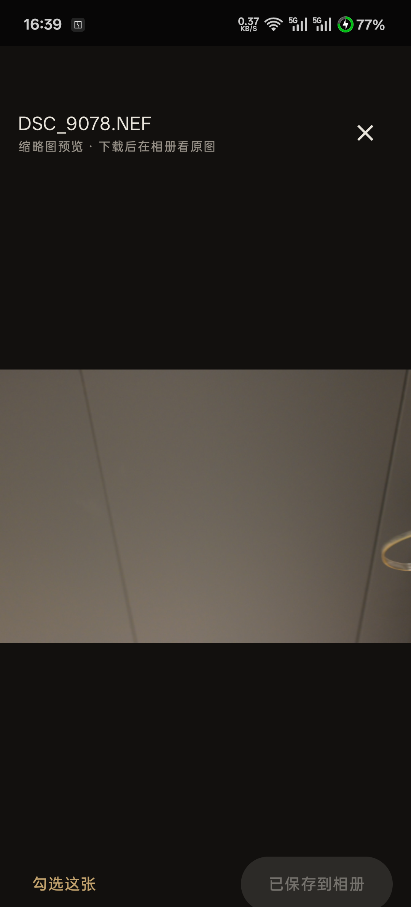
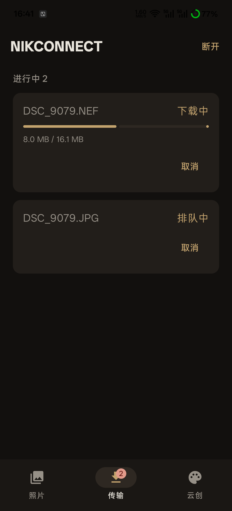
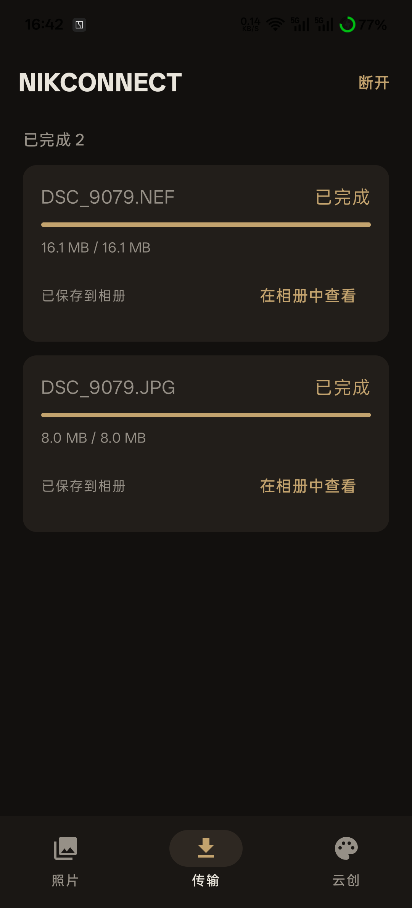
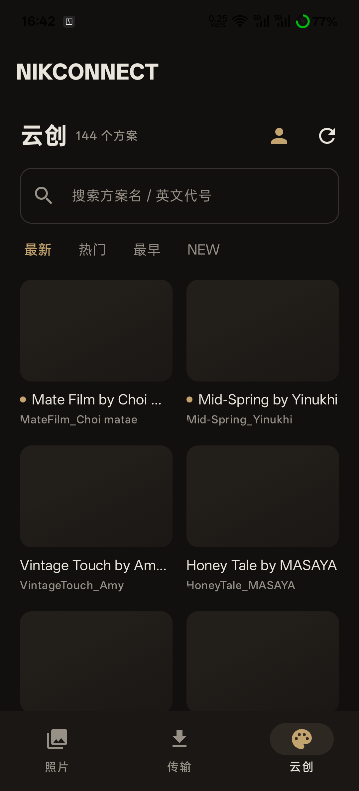
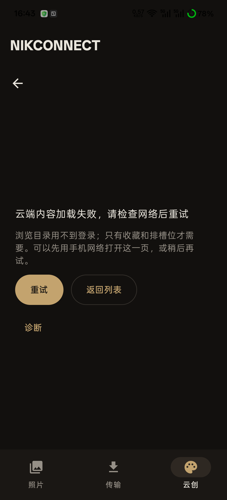

# NiKConnect UI / 交互审查（第三轮）

> 日期：2026-11-16  
> 设备：PKR110，1080 × 2376  
> 方式：相机热点连接后的无线 ADB 真机操作、截图与 UI 层级核对、Compose 源码核对  
> 范围：连接、照片大/中/小视图、格式筛选、多选、预览、双文件下载、传输、云创列表与详情。只审查，未修改应用代码。

## 结论先行

**照片浏览与下载主链路已经明显顺畅，第二轮的两个阻断性布局问题均已修复。** 传输页顶部不再穿透，预览页操作按钮完整可见，顶栏也不再串入其他页面的相机操作。

第三轮不需要重新推翻页面结构。剩余工作主要是：

1. 减少照片页顶部工具对首屏照片面积的占用。
2. 改善相机热点无互联网时云创列表的大片空白封面。
3. 统一照片选中色与全局金色强调体系。
4. 收敛网格圆角、云创重复信息和传输完成项的占用高度。

## 优先级总览

| 优先级 | 页面 | 当前问题 | 建议方向 |
|---|---|---|---|
| P1 | 照片列表 | 大标题、筛选、视图工具连续占高，首屏照片出现较晚 | 合并工具行，滚动时收缩品牌标题 |
| P1 | 云创列表 | 相机热点无互联网时，大量封面呈空白灰块 | 前置无网提示、缓存封面、明确占位图 |
| P2 | 照片多选 | 薄荷绿选中态与全局金色体系割裂 | 统一强调色，增强未选中边框 |
| P2 | 照片网格 | 统一方形比例和较大圆角仍略像圆角色块矩阵 | 中、小图减小圆角与间距，大图保留层次 |
| P2 | 云创列表 | 中文名、英文代号和正文重复竞争注意力 | 卡片仅保留主标题与关键元信息 |
| P3 | 传输 | 已完成任务仍占完整进度卡高度 | 完成态折叠为紧凑行，提供清除入口 |

---

## 1. 连接页

### 已改善

- 页面不再依靠卡片堆叠，两步连接说明直接排列。
- “相机和手机一断联，相机会关掉热点”的提示贴近真实使用场景。
- 主连接按钮清晰，首屏没有重复品牌与手动 IP 输入。

### 剩余问题

当前没有新的阻断性问题。连接失败时仍应注意只保留一个主要重试入口，避免错误区和页面底部形成两个同权重动作。

---

## 2. 照片列表

### 大视图

大视图已改成照片主体加一行文件名与容量，不再为每张图配置大下载按钮。视觉重点回到了照片，第二轮“功能卡列表”的问题已经解决。

### 中视图

中视图改为三列纯图片网格，去掉了重复文字面板和按钮。浏览效率明显提升。

### 小视图

小视图五列排列，适合快速定位照片；大、中、小三种模式已经形成真正的密度差异。

### P1 — 顶部工具占用仍偏高

大标题、格式筛选和“视图 大 / 中 / 小”连续占据顶部，首张照片约在屏幕四分之一处才出现。照片浏览时，工具比内容更先占据注意力。

建议：

- 将格式筛选与视图切换合并为一行紧凑工具条。
- 向下滚动后收起 NIKCONNECT 大标题，仅保留小型顶栏和必要状态。
- 保留当前显式“选择”入口，不再回到只能长按发现的方式。

### P2 — 网格圆角可进一步收敛

中、小图已经是正确方向，但统一方形比例和较大圆角仍略像圆角色块矩阵。

建议：中、小图圆角降至约 4–8dp，间距再紧凑一点；大视图保留当前圆角即可。照片量增加后再按拍摄日期分组，不必继续叠加筛选控件。

---

## 3. 多选与照片预览

### 多选

已实测：显式进入选择、选中数量、取消选择，以及选择两张照片后显示约 24 MB 的确认信息。主路径明确，功能可发现性比第二轮显著改善。

**P2 — 选中色与全局语义不统一。** 当前勾选使用薄荷绿，而筛选、主按钮和底部导航均使用金色，看起来像另一套组件状态。建议选中态统一使用金色；未选中边框与图片底色接近，也应适当增强。

### 预览

已实测：底部“勾选这张 / 下载这张”完整可见，不再被屏幕下沿裁切。“缩略图预览 · 下载后在相册看原图”也正确管理了用户对预览画质的预期。

源码核对：app/src/main/java/com/chrisz/nikconnect/ui/MainScreen.kt:745-855 已采用 decorFitsSystemWindows = false、底部锚定操作区和真实占位的底部 Spacer。当前按钮可用性已通过真机复核；操作区视觉位置仍偏低，但不再作为裁切缺陷记录。

---

## 4. 传输

### 下载中

已实测双文件下载过程：排队/下载中状态、进度和任务数徽标均正常，顶部统计与列表不再重叠或穿透。

### 已完成

两张文件均显示完成，大小分别为 16.1 MB 与 8.0 MB，并提供“在相册中查看”。本轮确认第二轮的传输列表缺失判断已被实际任务流程取代。

**P3 — 完成项可以进一步压缩。** 两个完成任务占据约半屏，满进度条和完整容量仍在重复表达“已经完成”。建议完成后折叠为文件名、大小与“查看”的紧凑行；任务较多时增加“清除已完成”。

---

## 5. 云创列表与详情

### 列表

两列网格比此前长卡片列表更适合浏览，页面顶栏也不再混入相机刷新/断开动作。

**P1 — 相机热点无互联网时封面成为空白灰块。** 列表缺少前置状态解释，用户容易理解为加载异常。建议：

- 检测无互联网时，在顶部提示“当前连接相机 Wi-Fi，云端封面与详情需手机网络”。
- 有缓存时优先展示缓存封面。
- 无缓存时使用带图片图标的明确占位，而不是纯灰块。

**P2 — 卡片信息仍有重复。** 中文名、英文代号与正文同时竞争注意力。建议每张卡只保留封面、主标题和一个关键元信息；英文代号移至详情页。

### 详情失败态

详情加载失败后展示用户可读说明、重试、返回列表和折叠诊断，不再直接暴露 DNS 原文。错误处理已经改善。

---

## 第二轮问题复核

| 第二轮问题 | 第三轮状态 | 依据 |
|---|---|---|
| 预览底部按钮被裁切 | **已修复** | 真机截图按钮文字完整；源码有底部安全区占位 |
| 传输统计与列表穿透 | **已修复** | 下载中及完成态截图均无重叠 |
| 顶栏相机动作串页 | **已修复** | 传输仅保留断开，云创无相机动作 |
| 照片大中视图重复功能卡 | **已修复** | 大图弱信息，中图三列纯图片，小图五列 |
| 多选只能长按发现 | **已修复** | 显式“选择”入口已实测 |
| 云创错误原文占据页面 | **已修复** | 友好错误、重试、返回与折叠诊断 |
| 云创卡片信息重复 | **仍存在** | 两列网格下仍需精简文字层级 |
| 页面卡片堆叠 | **主页面已明显改善** | 连接和照片页已去卡片化，传输完成态仍可压缩 |

## 验收与未验证项

### 本轮真机已验证

- 相机连接与照片列表加载。
- 大、中、小视图切换与 JPEG/RAW 筛选。
- 显式多选、数量与容量确认。
- 缩略图预览和底部操作区。
- 两张照片下载、实时进度、完成状态和相册入口。
- 云创列表、详情加载及无互联网失败态。

### 本轮未验证

- 有互联网环境下云创封面、成功详情与完整内容排版。
- 云创账号登录、收藏及槽位排布流程。
- 大量任务下的滚动、清除与历史记录表现。
- 多机型、字体缩放和系统三键导航下的预览布局。

本轮仅生成审查报告与证据图片，未修改应用代码。
